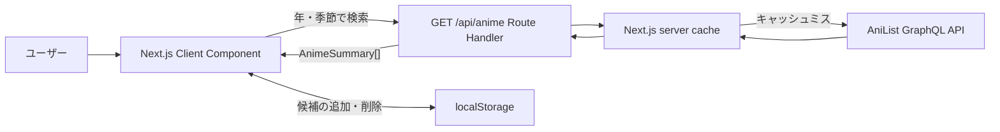

# Season Anime Picker — MVPアーキテクチャ

## 1. 目的

本書は「Season Anime Picker」MVPの技術構成、責務境界、テスト方針、およびディレクトリ構成を定義する。

要件の詳細は `docs/requirements.md` を正とし、本書では実装方法に関する判断だけを扱う。

## 2. 設計方針

- Next.jsの標準機能を優先し、実行時依存を最小限にする。
- 画面規模に見合わない状態管理、データ取得、バリデーションのライブラリを導入しない。
- AniList固有の処理、アプリ内のデータ操作、UIを分離する。
- フィルター、並び替え、保存データの検証は純粋関数として実装する。
- unit testはNode.js上で実行し、ブラウザ固有の振る舞いはE2E testで検証する。
- ローカルではnpmスクリプトだけで起動と検証を完結できるようにする。

## 3. 技術構成

| 領域 | 採用技術 | 選定理由 |
| --- | --- | --- |
| ランタイム | Node.js 22 LTS | Next.js 16とVitest 4を動かせるLTSを固定し、開発環境差を抑える |
| パッケージ管理 | npm | Node.jsに同梱され、追加ツールなしでローカル起動できる |
| アプリケーション | Next.js 16 App Router | UIとRoute Handlerを単一プロジェクトに置き、要件の構成を最小限で実現できる |
| UI | React + TypeScript | Next.jsの標準構成であり、画面状態と公開データ形式を型で固定できる |
| API通信 | Route Handler + 標準`fetch` | AniListへのプロキシ、入力検証、タイムアウト、エラー変換に外部HTTPクライアントは不要 |
| 状態管理 | React標準フック | 単一画面の検索結果、フィルター、候補リストには専用ストアが不要 |
| 永続化 | `localStorage` | サーバーやDBを追加せず、要件どおりブラウザ内だけで候補を保持できる |
| スタイル | CSS Modules + `globals.css` | UIフレームワークを追加せず、コンポーネント単位のスタイルとレスポンシブ対応ができる |
| unit test | Vitest 4 | TypeScriptとESMを扱え、純粋関数とRoute Handlerを少ない設定でテストできる |
| E2E test | Playwright Test 1.61 | Next.jsの自動起動、Chromium、モバイル幅、localStorageを含む操作を実ブラウザで検証できる |
| 静的検査 | ESLint + Next.js設定 | Next.jsとReactに固有の問題を標準的な構成で検出できる |

バージョンは実装開始時の対応範囲内で固定し、`package-lock.json` をコミットして再現性を確保する。

### 3.1 実行時依存

- `next`
- `react`
- `react-dom`

### 3.2 開発時依存

- `typescript`
- `@types/node`
- `@types/react`
- `@types/react-dom`
- `eslint`
- `eslint-config-next`
- `vitest`
- `@playwright/test`

### 3.3 初期導入しないもの

以下はMVPの規模では標準機能で代替できるため導入しない。

- Tailwind CSS、shadcn/ui、MUIなどのUI・CSSライブラリ
- AxiosなどのHTTPクライアント
- Zustand、Reduxなどの状態管理ライブラリ
- TanStack Query、SWRなどのデータ取得ライブラリ
- Zodなどのスキーマバリデーションライブラリ
- React Testing Library、jsdomなどのDOM unit test環境
- MSWなどのAPIモックライブラリ

外部入力とlocalStorageの検証には、小さな型ガードと正規化関数を使用する。これらで保守困難になった場合に限り、実測した必要性に基づいて依存追加を再検討する。

## 4. システム構成



### 4.1 UI

- `page.tsx` はサーバーコンポーネントのままとし、操作を持つ `SeasonAnimePicker` をクライアントコンポーネントにする。
- 検索条件、通信状態、取得済み一覧、フィルター、並び替え、候補一覧はReact標準フックで管理する。
- 表示結果とジャンル選択肢は取得済み一覧から導出し、重複したstateとして保持しない。
- 新しい検索時はクライアント側の `AbortController` で直前のリクエストを中断する。

### 4.2 Route Handler

- `GET /api/anime?year=YYYY&season=SEASON` をアプリ内の公開APIとする。
- 年と季節を型ガードで検証し、不正な入力には400を返す。
- AniListのページング、タイムアウト、429、上流エラーをアプリ固有の安全なレスポンスへ変換する。
- AniListのレスポンス本文、内部例外、スタックトレースをクライアントへ返さない。

### 4.3 AniListアダプター

- GraphQLリクエストには標準`fetch`を使用する。
- 対象シーズンの全ページを取得し、`isAdult = true` の作品を除外する。
- AniList固有レスポンスを画面で使う `AnimeSummary` に正規化する。
- タイトルの優先順位、欠損値、ステータス、フォーマットの変換をUIへ漏らさない。
- 年と季節をキーにNext.js標準のサーバーキャッシュを適用し、同一条件の短時間の重複アクセスを抑える。
- エラー結果とユーザー固有の候補データはキャッシュしない。

Next.jsのキャッシュAPIはバージョン依存の変更が起こり得るため、実装時は固定したNext.jsバージョンの公式ドキュメントに従う。キャッシュ境界はRoute Handler全体ではなく、正規化済みのシーズン一覧を返すサーバー関数とする。

### 4.4 クライアントドメイン処理

- フィルターと並び替えはAPIを再取得せず、取得済み一覧に対する純粋関数として実装する。
- 不明値の末尾配置と日本語ロケールによるタイトル比較をソート関数内で一貫して扱う。
- localStorageの読み書き、バージョン確認、AniList IDによる重複排除を `candidate-storage.ts` に集約する。
- SSR中はlocalStorageへアクセスせず、クライアント側の読み込み完了まで候補専用Skeletonを表示する。

## 5. 公開データ境界

`types.ts` には少なくとも次の型を定義し、Route Handler、UI、テストで共有する。

- `AnimeSeason`
- `AnimeStatus`
- `AnimeFormat`
- `AnimeSummary`
- `CandidateAnime`
- `AnimeSearchResponse`
- `ApiErrorCode`
- `ApiErrorResponse`

AniListの生レスポンス型は `server/anilist.ts` の外へ公開しない。localStorage形式は要件どおり `{ version: 1, items: CandidateAnime[] }` とし、キーは `season-anime-picker:candidates:v1` に固定する。

## 6. テスト方針

### 6.1 unit test

VitestはデフォルトのNode環境で使用し、初期段階ではjsdomを導入しない。主な対象は次のとおりとする。

- 現在年月から季節を求める処理と年の境界値
- 評価、話数、ジャンル、TV形式の単独・複合フィルター
- 欠損値と同順位を含む3種類の並び替え
- AniListレスポンスからアプリ内DTOへの正規化
- Route Handlerの入力検証、ページング、タイムアウト、エラー変換
- localStorageへ保存する値のデコード、破損復旧、重複排除

localStorage自体の挙動は、保存処理を文字列のencode/decodeとブラウザI/Oに分け、純粋な部分をunit testで検証する。

### 6.2 E2E test

Playwrightは初期段階ではChromiumだけを使用する。`webServer` でローカルのNext.jsを自動起動し、`baseURL` を設定する。

主な対象は次のとおりとする。

- 検索からフィルター、並び替え、候補追加・削除までの主要フロー
- 再読み込み後の候補復元
- 初期、ローディング、0件、一般エラー、429、タイムアウトの表示
- デスクトップと幅375pxでの主要操作および横スクロールの有無
- キーボード操作と主要なアクセシビリティ属性

通常のE2E testではブラウザから `/api/anime` のレスポンスを固定データへ差し替え、AniListの稼働状況やデータ更新に依存させない。Route HandlerとAniListアダプターの契約はunit testで補完する。

## 7. npmスクリプト

```text
npm run dev       ローカル開発サーバーを起動する
npm run build     本番用ビルドを作成する
npm run start     本番相当のサーバーを起動する
npm run lint      ESLintを実行する
npm test          unit testを1回実行する
npm run test:watch
                   unit testをwatchモードで実行する
npm run test:e2e  E2E testを実行する
```

初回のE2E実行前のみ、PlaywrightのChromiumをインストールする必要がある。

## 8. ディレクトリ構成

```text
season-anime-picker/
├── docs/
│   ├── architecture.md
│   └── requirements.md
├── public/
│   └── cover-placeholder.svg
├── src/
│   ├── app/
│   │   ├── api/
│   │   │   └── anime/
│   │   │       └── route.ts
│   │   ├── globals.css
│   │   ├── layout.tsx
│   │   └── page.tsx
│   └── features/
│       └── season-picker/
│           ├── components/
│           │   ├── AnimeCard.module.css
│           │   ├── AnimeCard.tsx
│           │   ├── CandidateList.module.css
│           │   ├── CandidateList.tsx
│           │   ├── FilterControls.module.css
│           │   ├── FilterControls.tsx
│           │   ├── SearchForm.module.css
│           │   ├── SearchForm.tsx
│           │   ├── SeasonAnimePicker.module.css
│           │   └── SeasonAnimePicker.tsx
│           ├── server/
│           │   └── anilist.ts
│           ├── candidate-storage.ts
│           ├── filter-and-sort.ts
│           ├── season.ts
│           └── types.ts
├── tests/
│   ├── e2e/
│   │   ├── fixtures/
│   │   │   └── anime-response.ts
│   │   └── season-picker.spec.ts
│   └── unit/
│       └── season-picker/
│           ├── anilist.test.ts
│           ├── candidate-storage.test.ts
│           ├── filter-and-sort.test.ts
│           ├── route.test.ts
│           └── season.test.ts
├── eslint.config.mjs
├── next.config.ts
├── package-lock.json
├── package.json
├── playwright.config.ts
├── tsconfig.json
└── vitest.config.ts
```

汎用的な `utils/`、`services/`、`repositories/` は設けない。機能固有の処理は `season-picker/` に置き、別機能から再利用する具体的な必要が生じた時点で移動を検討する。

## 9. 公式ドキュメント確認

2026-08-01時点で、Context7を使用して次の公式ドキュメントを確認した。

- [Next.js — Installation](https://nextjs.org/docs/app/getting-started/installation)
- [Next.js — Route Handlers](https://nextjs.org/docs/app/api-reference/file-conventions/route)
- [Vitest — Test Environment](https://vitest.dev/guide/environment.html)
- [Playwright — Web Server](https://playwright.dev/docs/test-webserver)
- [Playwright — Basic Configuration](https://playwright.dev/docs/test-configuration)

確認対象はNext.js 16.2.9、Vitest 4.1.6、Playwright 1.61.0。実装時にはこの方針を維持しつつ、インストール時点の互換性を確認してパッチバージョンを固定する。
